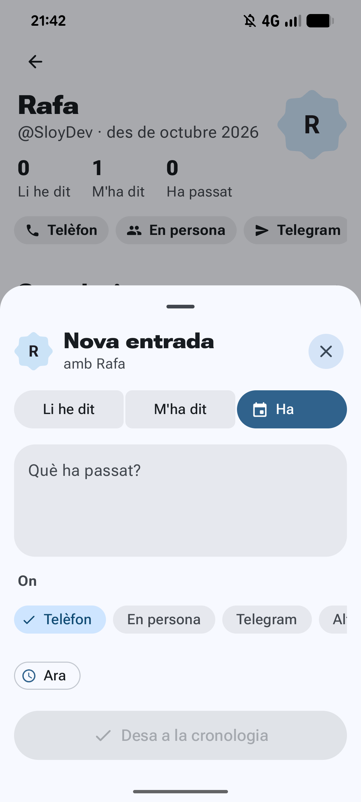
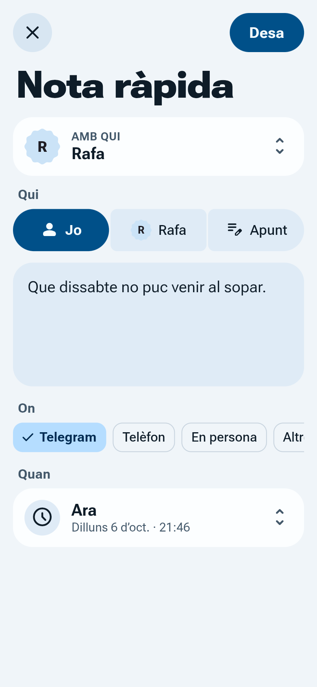
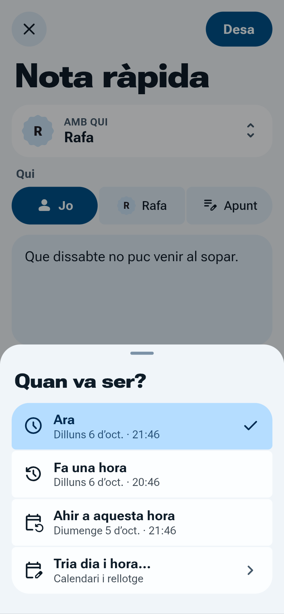
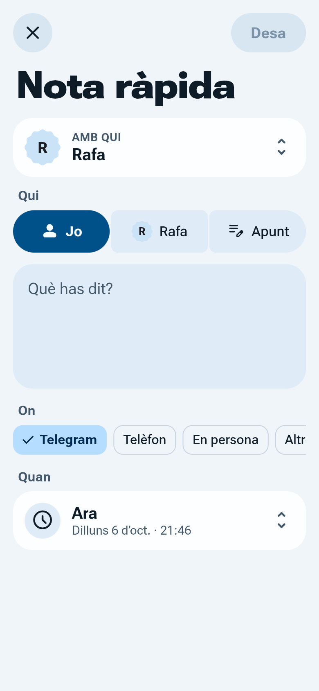
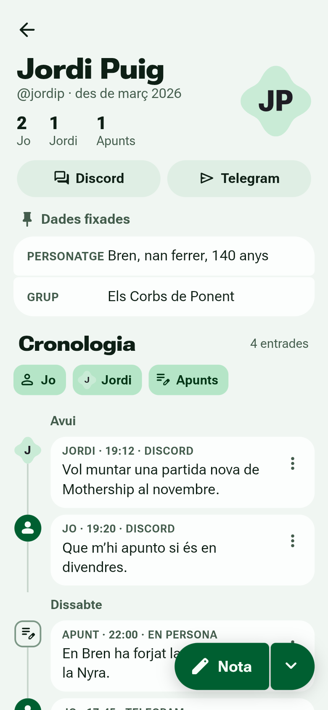

# Backlog: bugs i features pendents

Última actualització: 2026-10-06.

Aquí hi ha el detall de tots els punts. Els que també són issues a GitHub ho indiquen a la columna "Issue".

| # | Tipus | Tema | Issue |
| --- | --- | --- | --- |
| 1 | Bug | L'àrea clicable surt fora de la superfície | [#6](https://github.com/alorma/Contacts-Notes/issues/6) |
| 2 | Bug | La pantalla de bloqueig de persona mostra el layout | — |
| 3 | Bug | Canal "Other" ha de mostrar "Other - {valor}" | — |
| 4 | Bug | A "Nova entrada", "Ha passat" es talla | — (queda resolt pel 9) |
| 5 | Bug | Activar/desactivar biometria sense desar el perfil | [#4](https://github.com/alorma/Contacts-Notes/issues/4) |
| 6 | Feature | Follow-ups / entrades pendents | [#5](https://github.com/alorma/Contacts-Notes/issues/5) |
| 7 | Feature | Nou canal "Empresa" | — |
| 8 | Feature | Gestor de canals propis | — |
| 9 | Feature | «Qui» i «Quan» a les entrades ([especificació](qui-i-quan.md)) | — |

---

## 1 · Bug: l'àrea clicable surt fora de la superfície dels elements

Issue: [#6](https://github.com/alorma/Contacts-Notes/issues/6)

L'efecte de clic (ripple) i l'àrea clicable surten per fora de la superfície visible de l'element. S'ha vist a **Ajustos**, però cal revisar totes les pantalles.

**Què cal fer**
- Revisar `ui/settings/SettingsScreen.kt` i la resta de pantalles (llista, detall, edició, fulls inferiors).
- Normalment passa quan `Modifier.clickable` va abans del `clip`/`background`: l'ordre ha de ser `clip(shape)`, després `clickable`, després `padding`. O fer servir les variants de `Surface`/`ListItem` amb `onClick`, que ja retallen.
- Si hi ha un component compartit al `designsystem`, arreglar-ho allà.

## 2 · Bug: la pantalla de bloqueig d'una persona mostra el layout

Quan s'obre una persona amb bloqueig biomètric, la pantalla de bloqueig mostra el layout mentre es demana la biometria.

**Comportament proposat**
- Mentre es demana la biometria: només un estat de **càrrega** (sense layout de la persona).
- Si l'usuari **cancel·la** o falla: estat d'**error** amb un botó per tornar-ho a intentar (i/o tornar enrere).
- Si no hi ha biometria disponible: missatge clar i un botó d'acció (desbloquejar amb credencial del dispositiu o tornar).

**Fitxers:** `ui/person/PersonLockedScreen.kt`, `ui/person/BiometricUnlock.kt`. Textos nous a `strings.xml` (en, ca, es).

## 3 · Bug: el canal "Other" hauria de mostrar "Other - {valor}"

`ChannelType.OTHER` es mostra només com a "Other"/"Altre", sense el valor introduït (p. ex. "Signal").

**Esperat:** `Other - Signal` (`Altre - Signal`, `Otro - Signal`). Si el valor és buit, només "Other".

**Què cal fer**
- String amb format, p. ex. `channel_other_with_value` = `"Other - %1$s"` a `values/`, `values-ca/` i `values-es/`.
- Fer-lo servir on es pinta el nom del canal: xips del detall, selector "On" del formulari d'entrada, cronologia.

**Fitxers:** `ui/people/PeopleFormatting.kt`, `ui/person/PersonFormatting.kt`, `ui/entry/EntryForm.kt`.

**Relació amb el 9:** el 9 canvia l'etiqueta de cada entrada a **qui · hora · canal** (`JO · 19:20 · DISCORD`). Una entrada només desa `channelType`, no el valor de «Other». Per mostrar `OTHER - SIGNAL` a la cronologia, a les accions d'entrada i a l'exportació, cal buscar el `handle` del canal `OTHER` de la persona. Si es fa després del 9, cal aplicar-ho també a l'etiqueta nova.

## 4 · Bug: a "Nova entrada", l'opció "Ha passat" es talla

> **Queda resolt pel 9.** El selector passa a ser «Qui: Jo · {nom} · Apunt», amb textos curts i icona sempre visible. Quan es faci el 9, cal comprovar que no es talla amb noms de 12 caràcters, en ca/es i amb font gran. Si es tallés, aplicar alguna de les opcions de sota.

El grup de botons de tipus (Li he dit / M'ha dit / Ha passat) es talla: amb "Ha passat" seleccionat i la icona, només es veu "Ha".

**Opcions**
- Fila amb scroll horitzontal (com el selector "On").
- No afegir la icona a l'element seleccionat o redistribuir l'amplada perquè el text càpiga.
- Permetre 2 línies o reduir el padding.

Comprovar-ho en català i castellà (textos més llargs) i amb mida de font gran.

**Fitxers:** `ui/entry/EntryForm.kt`, `ui/entry/NewEntrySheet.kt`.

## 5 · Bug: activar/desactivar la biometria d'una persona no hauria de requerir desar el perfil

Issue: [#4](https://github.com/alorma/Contacts-Notes/issues/4)

Ara mateix, per activar o desactivar el bloqueig biomètric d'una persona cal canviar l'interruptor i després **desar el perfil**.

**Esperat:** el canvi s'aplica directament en canviar l'interruptor, sense haver de desar la resta del formulari.

**Notes**
- Separar aquest camp de l'estat del formulari d'edició i desar-lo amb una crida pròpia al repositori/DAO.
- Valorar demanar la biometria abans de **desactivar**-la, perquè ningú la pugui treure sense autenticar-se.
- Si s'està creant una persona nova (encara sense id), mantenir el comportament actual.

**Fitxers:** `ui/edit/EditPersonScreen.kt`, `ui/edit/EditPersonViewModel.kt`.

## 6 · Feature: follow-ups / entrades pendents a la cronologia

Issue: [#5](https://github.com/alorma/Contacts-Notes/issues/5)

Poder marcar coses per fer-ne seguiment amb una persona ("li he de preguntar com li ha anat l'entrevista", "m'ha de tornar el llibre"...).

**Opcions a decidir**
1. **Marcar una entrada com a pendent**: un flag `pending` (i opcionalment una data de recordatori) a les entrades existents, que es pot marcar i desmarcar des de la cronologia.
2. **Nou tipus d'entrada "Follow-up"** al costat de Li he dit / M'ha dit / Ha passat.

La 1 sembla més simple i flexible: qualsevol tipus d'entrada pot quedar pendent.

**Relació amb el 9:** el 9 converteix el tipus en «Qui» (Jo · {nom} · Apunt), un grup de 3 botons iguals. Un quart tipus «Follow-up» no hi encaixa, perquè no respon a «qui». Això reforça l'opció 1: un flag `pending` independent de «Qui» (per exemple, un interruptor o xip «Pendent» a sota de «Quan» al formulari comú).

**A tenir en compte**
- Migració de Room (nova columna).
- Indicador visual a la cronologia i potser un comptador o filtre de pendents al detall de persona i a la llista.
- Opcional: recordatori o notificació en una data.
- Textos a `strings.xml` (en, ca, es) i actualitzar `docs/plan.md`.

## 7 · Feature: nou canal "Empresa" (entrevistes de feina)

- Afegir el valor a `enum class ChannelType` (`data/db/Entities.kt`); comprovar el converter de Room i si cal migració.
- Icona a `ui/person/PersonFormatting.kt` (p. ex. `Icons.Rounded.Business` o `Work`).
- String a `ui/people/PeopleFormatting.kt` + `strings.xml` (en: "Company", ca/es: "Empresa").
- Decidir a quin `ChannelFilter` (`ui/people/PeopleListViewModel.kt`) pertany.

Si es fa abans el gestor de canals (8), potser passa a ser un canal creat per l'usuari.

## 8 · Feature: gestor de canals (crear canals globals propis)

Permetre crear canals propis (Signal, LinkedIn, Empresa...) en lloc de dependre només de l'enum `ChannelType` + "Other".

**Idea**
- Pantalla de gestió de canals (des d'Ajustos): llistar, crear, reanomenar, triar icona, reordenar, esborrar/arxivar.
- Els canals actuals es mantenen com a canals de sistema.

**Impacte tècnic**
- Passar de l'enum a una taula `Channel` a Room (id, nom, icona, sistema/usuari, ordre) amb migració, incloent convertir els `OTHER` amb valor en canals propis.
- Afecta: detall de persona, formulari d'entrada, edició de persona, `ChannelFilter`, `ui/person/ChannelLinks.kt` i `PersonExporter.kt`.
- Els noms creats per l'usuari no es tradueixen.

## 9 · Feature: «Qui» i «Quan» a les entrades

Especificació completa: [`docs/qui-i-quan.md`](qui-i-quan.md), amb les captures del disseny a `docs/img/qui-i-quan/`.

| 3c · Nota ràpida | 3d · «Quan va ser?» | 3e · Selector «Qui» | 2e · Cronologia |
| --- | --- | --- | --- |
|  |  |  |  |

**Resum**
- El tipus «Li he dit · M'ha dit · Ha passat» passa a ser **«Qui»: Jo · {nom} · Apunt**. `{nom}` és el primer mot del nom, tallat amb «…» si passa de 12 caràcters. `EntryKind` no canvia (`SAID` / `HEARD` / `HAPPENED`), així que no cal migració.
- El xip «Ara» passa a ser una **fila «Quan»** que obre el full «Quan va ser?»: Ara, Fa una hora, Ahir a aquesta hora i Tria dia i hora….
- **Un sol formulari** amb el mateix ordre (Amb qui → Qui → Text → On → Quan) a la nota ràpida, al full de nova entrada i a l'edició.
- La **cronologia** fa servir la terminologia nova: comptadors `Jo · {nom} · Apunts`, filtres amb avatar, marcadors de 32 dp (l'avatar de la persona per a `HEARD`) i l'etiqueta `qui · hora · canal`.
- **Exportar notes** fa servir `Jo:`, `{Nom}:` i `Apunt:`.

**Com està el codi avui** (punt de partida)
- `ui/entry/EntryForm.kt` ja té peces comunes (`EntryFormState`, `KindSelector`, `EntryTextField`, `WhereSection`, `TimeChip`), però el formulari es munta dues vegades: a `QuickNote.kt` i a `NewEntrySheet.kt`. L'edició d'una entrada reutilitza `NewEntrySheet` amb `initial`. Cal extreure un `EntryForm` composable únic amb un slot per a «Amb qui» i un altre per al botó Desa.
- `EntryFormState.occurredAt == null` ja vol dir «ara en desar», i `updateEntry` ja manté la data si no es toca. Per al full cal distingir l'opció triada: `Now`, `HourAgo`, `Yesterday`, `Custom` o la data desada d'una entrada que s'edita, sense cap opció marcada. Cal afegir-la al `Saver`.
- `ConversesToggleGroup` (`designsystem`) només mostra la icona a l'opció seleccionada i només accepta `ImageVector`. «Qui» necessita la icona sempre visible, l'`Avatar` de 26 dp com a contingut, 52 dp d'alt, pes 700/500, una opció desactivada i `role = RadioButton`. S'ha de fer al `designsystem` (és on van els `@OptIn` d'Expressive). La fa servir també el tema d'Ajustos, així que no s'hi pot trencar res.
- `TimelineMarker` fa 40 dp i té tres estils fixos (`Filled`, `Tonal`, `Outlined`). Cal passar-lo a 32 dp, fer el quadrat de radi 10 i permetre un marcador amb contingut propi (l'avatar). `TimelineRow` fa servir `MarkerSize` per a l'amplada de la columna i el centre de la línia.
- Les etiquetes es construeixen en tres llocs amb `EntryKind.label()`: `EntryCard` (detall), la capçalera de `EntryActionsSheet` i `PersonExporter`. Convé una sola funció `whoLabel(kind, firstName)`. L'exportador no és composable i necessita `Context`.
- Els filtres de la cronologia ja són de multiselecció (`selectedKinds`). Falta amagar els que no tenen entrades, amb els comptadors `saidCount`/`heardCount`/`happenedCount` que ja hi ha. `ConversesFilterChip` només accepta `ImageVector`, així que caldrà un slot per a l'avatar de 22 dp.
- Els xips d'«On» ara són `ConversesFilterChip` tonal sense vora. El disseny els vol amb radi 12, 36 dp d'alt i vora `outlineVariant` quan no estan seleccionats.
- Strings a substituir: `kind_said`, `kind_heard`, `kind_happened`, `entry_label_*`, `quick_where` i `time_now`. Comprovar `timeline_filtered_empty` («No hi ha entrades de %1$s»), que rep la llista de filtres actius i haurà de rebre els noms nous.

**Pla en commits petits**
1. Textos i strings (en, ca, es): claus noves de la taula de l'especificació. Les antigues s'esborren al commit que les deixa de fer servir.
2. `EntryForm` comú amb «Qui» (component nou o `ConversesToggleGroup` ampliat al `designsystem`) i l'ordre nou dels camps; títols de secció `labelLarge` 14/700, 14 dp entre seccions. Inclou el camp de text a 120 dp i 17 sp i els xips d'«On» amb vora.
3. Fila «Quan» + full «Quan va ser?» + `DatePickerDialog` (`selectableDates` fins a avui) i `TimePicker` de 24 h. El subtítol d'«Ara» es refresca cada minut. Format `EEEE d MMM` amb la primera lletra en majúscula.
4. Cronologia: marcadors de 32 dp amb avatar, etiquetes `qui · hora · canal`, filtres (avatar de 22 dp, amagats si estan buits), comptadors i capçalera del full d'accions.
5. Exportar notes amb `Jo:`, `{Nom}:` i `Apunt:`.
6. Previews i tests:
    - previews d'`EntryForm` (3 valors de «Qui» × text buit o ple), `WhenSheet` i `TimelineRow` (els tres tipus);
    - tests unitaris del primer mot i del tall a 12, del format de data i de les opcions de «Quan»;
    - regenerar les referències de captures (`personDetail*` i les de components canviaran). Es pot fer amb l'etiqueta `update-screenshots` a la PR, perquè en aquest entorn no hi ha SDK d'Android.

**Accessibilitat:** vegeu la secció 5 de l'especificació (rol de ràdio, entrada llegida sencera, descripció de la fila «Quan»).

**Interacció amb altres punts:** resol el 4; afecta el 3 (etiqueta de canal «Other») i el 6 (on posar «pendent»).
